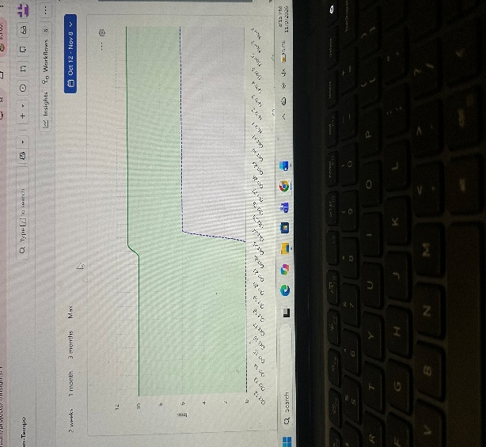

# Metrics & EVM Report: Urban Tempo Smart Fleet & Transit

## Velocity & Burn-Up Performance Analysis

| Metric                  | Sprint 1 | Sprint 2               | Trend      |
|-----------------------------|--------------|----------------------------|----------------|
| Velocity (points completed) | 47           | 16                         | Down 31 points |
| Issues completed            | 11           | 4                          | Down 7         |
| Average points per issue    | 4.3          | 4.0                        | Stable         |
| Average velocity            |              | **31.5 points per sprint** |                |

### Analysis

- **The work was front-loaded.** Sprint 1 delivered 47 points, about 59% of the whole project. The team took on most of the foundation work early: the charter, RACI, epics, backlog setup and core system planning.

- **The velocity drop reflects sprint size, not slower work.** Sprint 2 had fewer issues (4 vs. 11), but the average issue size held steady (4.0 vs. 4.3 points). The team finished everything it committed to in both sprints.

- **The burn-up chart shows the team ahead of plan.** By the end of Sprint 2, completed work (63 points) is well above the two-thirds mark of 53.3 points. The total-scope line stayed flat at 80 points because the CCB deferred the passenger-crowding feature instead of adding it.

- **Sprint 3 is well within capacity.** 17 points remain. That is just above Sprint 2's velocity of 16 and far below the 31.5-point average, so the team can finish before the Nov 20 pilot launch.

### Burn-Up Chart

## Earned Value Management (EVM) Calculations

| Metric                           | Formula        | Calculation | Result    |
|--------------------------------------|--------------------|-----------------|---------------|
| Budget at Completion (BAC)           | Total story points | 47 + 16 + 17    | **80 pts**    |
| Planned Value (PV)                   | ⅔ × BAC            | ⅔ × 80          | **53.33 pts** |
| Earned Value (EV)                    | Points completed   | 47 + 16         | **63 pts**    |
| Actual Cost (AC)                     | ⅔ × BAC            | ⅔ × 80          | **53.33 pts** |
| Schedule Variance (SV)               | EV − PV            | 63 − 53.33      | **+9.67 pts** |
| Cost Variance (CV)                   | EV − AC            | 63 − 53.33      | **+9.67 pts** |
| **Schedule Performance Index (SPI)** | EV ÷ PV            | 63 ÷ 53.33      | **1.18**      |
| **Cost Performance Index (CPI)**     | EV ÷ AC            | 63 ÷ 53.33      | **1.18**      |

### What it means

- **SPI 1.18:** The team has completed 18% more work than planned by this point. It is ahead of schedule.

- **CPI 1.18:** Each unit of budget spent has produced 1.18 units of value. It is under budget.

- Both indexes are above 1.0, which is **healthy**.

## Sprint 3 Forecast

| Metric                       | Formula | Calculation | Result     |
|----------------------------------|-------------|-----------------|----------------|
| **Estimate at Completion (EAC)** | BAC ÷ CPI   | 80 ÷ 1.18       | **67.72 pts**  |
| **Estimate to Complete (ETC)**   | EAC − AC    | 67.72 − 53.33   | **14.39 pts**  |
| Variance at Completion (VAC)     | BAC − EAC   | 80 − 67.72      | **+12.28 pts** |

**Forecast:** At the current efficiency, the project will finish at about **67.7 points of cost against an 80-point budget**, roughly **15% under budget**. Sprint 3 should need about **14.4 points of effort** to deliver its 17 points of planned work.
